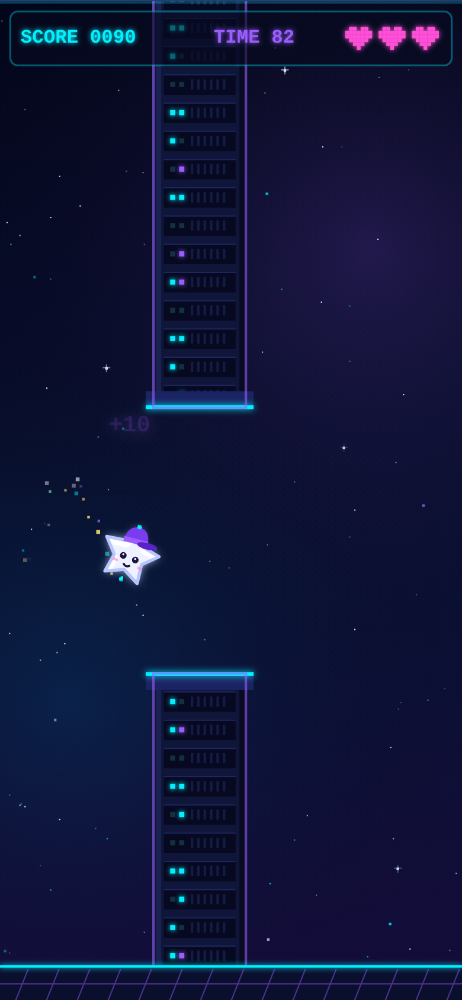

# Flappy Pilo

A CyCade-style arcade flapper. Guide **Pilo**, a little white star in a purple cap, through glowing server-rack pillars in deep space, grab Cysic coins, and rack up the highest score you can in a 90-second round.

The whole game is one self-contained `index.html` (HTML5 canvas, inline JS/CSS, no external assets or dependencies). It works on phones and desktop browsers.

**▶ Play it live:** https://flappy-pilo.vercel.app/



## Controls

| Platform | Flap | Start / Play again |
|----------|------|--------------------|
| 📱 Mobile | Tap anywhere on the screen | Tap the screen / the **PLAY AGAIN** button |
| 💻 PC | `Space` (also `↑`, `W`, `Enter`) or mouse click | `Space` / click **PLAY AGAIN** |

## Scoring & rules

- **+10** for each pair of pillars you pass.
- **+25** for each Cysic coin you collect.
- You have **3 lives (hearts)**. Hitting a pillar, the floor, or the ceiling costs one life, followed by ~1.5 s of invulnerability (Pilo blinks).
- Each round lasts **90 seconds**. The pillar gap slowly tightens and the speed rises as time runs down.
- The game ends when you run out of lives or time. Your **best score** is saved in your browser (localStorage).

## Run locally

No build step, no server needed: just download or clone this repo and open `index.html` in any modern browser.

```bash
git clone https://github.com/comzzy/flappy-pilo.git
cd flappy-pilo
# then open index.html in your browser (double-click it)
```

## Credits

- Built in the style of **CyCade**, the Cysic community arcade.
- The coin uses the **Cysic logo** (the Cysic "C" symbol) as used for the coins in CyCade's *Midnight Drift*. The Cysic name and logo belong to their respective owners and are not covered by this repo's license.

## License

The code is released under the [MIT License](LICENSE). © 2026 Kane (comzzy)
